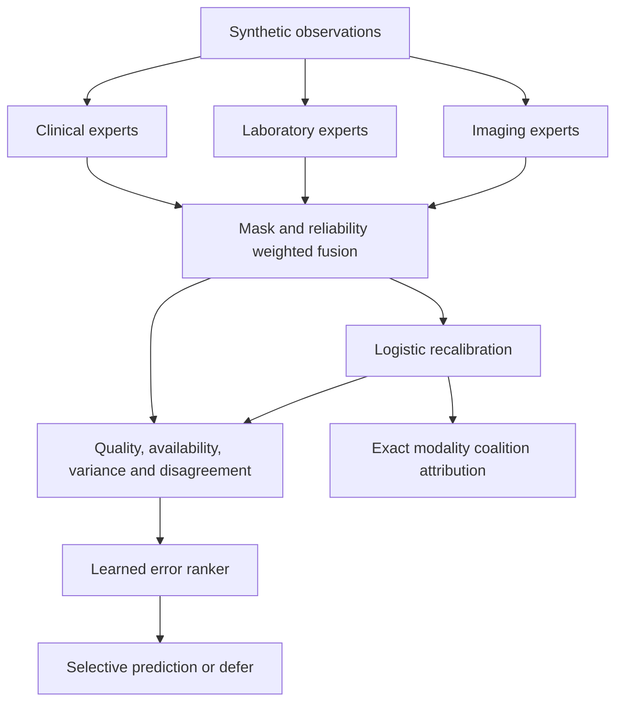

# AURA — Disagreement-aware selective prediction

**Susmit Naskar** · Department of Computer Science and Engineering, Institute of Engineering and Management, Kolkata, India

Companion repository for *AURA: Assessing the Limits of Disagreement-Aware Selective Prediction in an Axial Spondyloarthritis-Inspired Synthetic Benchmark*, manuscript V3.0 (25 November 2026). Manuscript under review; not an accepted IEEE publication.

> **Research only:** all data are simulated. No patient records, clinical MRI pixels, clinical validation or diagnostic use. Do not enter personal medical information into the demo. The scores are conditional on an illustrative synthetic generator.

## Overview

AURA tests a narrow question: does inter-modality prediction disagreement improve error ranking beyond confidence, modality availability and quality? It trains bootstrap logistic experts for three simulated modalities, estimates reliability from a separate gate partition, calibrates the fused score, and learns an error ranker on a separate development partition. The primary ablation holds predictions fixed and adds only the disagreement feature.



## Quick start

Tested locally with Python 3.13.5 and the exact versions in `requirements.txt`. No GPU, API key, external datasets or network are required for experiments after installing packages. The install step itself may require internet.

```bash
python -m venv .venv
# macOS / Linux / WSL:
source .venv/bin/activate
# Windows PowerShell alternative: .venv\Scripts\Activate.ps1
python -m pip install -r requirements.txt
python -m unittest discover -s tests -v
python -m aura.demo
```

### Mentor demonstration

Open [`docs/mentor_demo.html`](docs/mentor_demo.html) locally in a browser for the executed report with figures, or open [`AURA_Mentor_Demo.ipynb`](AURA_Mentor_Demo.ipynb) in Jupyter/VS Code. The notebook retrains seed 0, reproduces its held-out metrics against the archived CSV, demonstrates masked inputs and attribution, and visualizes the full benchmark. Run `python -m pip install -r requirements-notebook.txt` to use JupyterLab. For Colab, upload/extract the repository archive, change to its root, install the pinned dependencies and run the notebook; compatibility on Colab is not independently tested.

### Full reviewer reproduction

```bash
python revision_experiment.py
python verify.py
python report.py
```

The benchmark uses ten independently seeded generated populations, 10,000 records per seed, five disjoint development/test partitions, seven conditions, six classifiers and matched ranking rules. It writes regenerated outputs to `revision_results/`. `reference_results/` contains the untouched CSVs from manuscript V3.0. `verify.py` compares all ten files with strict numerical tolerances and verifies key dimensions and prediction invariance. The checked local run produced 1,400 primary evaluations, 630 sensitivity evaluations, and a maximum absolute difference of approximately 1.11e-16 relative to the archived outputs. See [`docs/reproduction_report.txt`](docs/reproduction_report.txt) and [`docs/full_run.log.txt`](docs/full_run.log.txt). GitHub Actions is configured to run unit tests and a manually triggered full reproduction; remote Actions has not yet been run.

To regenerate manuscript tables and figures (optional), run `python build_revision.py` followed by `python finalize_manuscript.py`. With a TeX distribution including IEEEtran, compile `pdflatex AURA_Final.tex` twice. These legacy publication scripts preserve editorial history and overwrite generated manuscript files; use a separate working copy. The existing final PDF is the reviewed source of record. The original `experiment.py` reproduces V1.0, not the final benchmark.

## Main findings

Macro means over ten seeds and seven conditions, with identical classifier probabilities across rankings:

| Classifier | AUROC | AUPRC | Brier | Matched full AURC |
|---|---:|---:|---:|---:|
| Early logistic | 0.82960 | 0.73295 | 0.15938 | 0.11998 |
| AURA | 0.82706 | 0.71923 | 0.16136 | 0.12191 |

For native AURA, adding disagreement changes AURC by −0.000138 (95% seed-level interval −0.000692 to +0.000415); this is inconclusive, not an equivalence result. All nine one-factor sensitivity intervals include zero. Early logistic regression is the stronger simple control here. The benchmark does not establish clinical accuracy or the superiority of late fusion.

## Repository map

| Path | Purpose |
|---|---|
| `aura/core.py` | Simulator, masking, model primitives, tie-aware risk and coalition attributions |
| `aura/demo.py` | Live seed-specific training and synthetic demonstration with no-evidence guard |
| `revision_experiment.py` | Main reproducible V3 benchmark and statistical analysis |
| `verify.py` | Compare rerun against manuscript reference artifacts |
| `report.py` | Generate concise results tables and sensitivity chart |
| `tests/test_aura.py` | Implementation and live inference tests |
| `AURA_Mentor_Demo.ipynb` | Executed mentor walkthrough |
| `docs/mentor_demo.html` | Browser-readable notebook export |
| `reference_results/` | Frozen V3 experiment CSVs |
| `revision_results/` | Latest regenerated CSVs |
| `synthetic_seed0.csv` | Example clean generated population |
| `AURA_Final.tex`, `AURA_Final.pdf` | Final manuscript source and PDF |
| `literature_matrix.csv`, `FINAL_AUDIT.md` | Literature and editorial checks |
| `docs/` | Data dictionary, method guide, reproduction and GitHub instructions |
| `.github/workflows/reproduce.yml` | CI unit tests and on-demand full benchmark |

## Citation and reuse

Cite the manuscript as an unpublished research manuscript unless and until it is accepted. See `CITATION.cff`. No public repository URL or DOI is asserted. Author identity, contribution, co-authorship and public-release permissions require human confirmation. No open-source license is assigned without author approval; decide on code and manuscript/data permissions before public release. IEEE venue rules may require anonymized supplementary material or restrict preprint posting; see `docs/github_release.md`.

## AI disclosure

OpenAI ChatGPT contributed substantially to research design, implementation, analysis, figures, tables and manuscript drafting; it also assisted in preparing this repository and demonstration. Human authors must review the code, references, clinical assumptions, results and conclusions before submitting or releasing it. No clinical validation or independent human verification is implied by automated checks.
